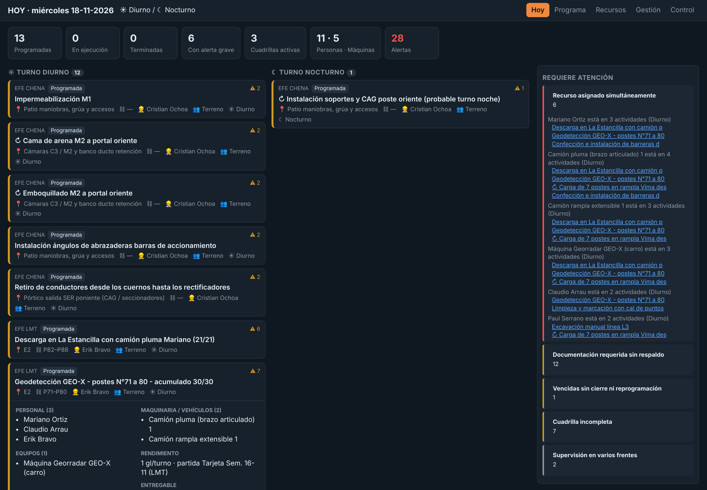

# PROPUESTA — Pizarra Operativa 2.0 (Etapa 2)

Basada en `AUDITORIA.md`. Esta etapa no modifica la aplicación. Para revisarla, abre `propuesta/maqueta_HOY.html`, generada con los datos reales del 18-11-2026.

## 1. Principios

- **No reescribir:** la 2.0 es el mismo HTML con una capa nueva encima. El lienzo Día, las vistas Semana/Mes, Last Planner, el motor Excel y las plantillas oficiales siguen intactos.
- **Original intacto:** `original/` no se toca. La 2.0 se genera en `version2/Pizarra_Operativa_2.0.html` con `tools/build`.
- **Fuentes legibles:** el código nuevo vive en `src/*.js` y `src/*.css`, sin minificar, y se inserta en el HTML al compilar.
- **Un solo punto de contacto con el bundle:** una línea expone `window.__PIZARRA` (store, React, jsx, motor Excel y guardado de archivos). Todo lo nuevo usa ese puente.

## 2. Estructura de archivos

```
original/Pizarra_Operaciones_2026-11-13.html   ← respaldo íntegro (SHA-256 en AUDITORIA.md)
src/
  puente.patch.json      ← los únicos reemplazos de texto en el bundle (con verificación de que existen 1 vez)
  hoy.js                 ← módulo HOY
  ficha.js               ← tarjeta resumida + detalle desplegable
  navegacion.js          ← 5 módulos y submenús
  alertas.js             ← reglas extendidas (envuelve Mr, no lo reemplaza)
  gestion-persistencia.js← guardar Preventivas/PM/Cortadas en el plan
  estilos.css
tools/build.(py|js)      ← original + parches + src → version2/
tests/                   ← Playwright: apertura, regresión, Excel, persistencia, móvil
version2/Pizarra_Operativa_2.0.html
```

## 3. Los cinco módulos (asignación de las vistas existentes)

| Módulo | Contenido | Origen |
|---|---|---|
| **HOY** (inicio) | Situación del día: tarjetas por turno, estado, indicadores reales y alertas | **nuevo** |
| **PROGRAMA** | Día (línea de postes) · Mañana · Semana · 3 semanas · Mes · Last Planner · Avance · Término · Tarjetas · filtros por obra, turno y disciplina | existentes, reubicados |
| **RECURSOS** | Dotación (personas, máquinas, equipos), Cuadrillas (configuraciones), disponibilidad por día | panel izquierdo existente, más una vista de disponibilidad nueva de solo lectura |
| **GESTIÓN** | Pedidos PM y catálogo PEP · Abastecimiento (`abast`, hoy oculto) · Preventivas EPF y semanas tipo · Cortadas · Agenda (coordinación) · Panel Informe y plantillas | existentes, reubicados; se agrega persistencia |
| **CONTROL** | Alertas completas · Restricciones (Last Planner) · Avance plan versus real (de `avance` y `programa`) · Bitácora de cambios | alertas y Last Planner existentes; bitácora nueva |

La barra superior queda así: **obra · fecha · [Hoy | Programa | Recursos | Gestión | Control] · ⚠ alertas · Guardar · ☰**. Las sub-vistas aparecen solo dentro del módulo activo.

## 4. Pantalla HOY



- **Encabezado:** fecha, turno y obra (o todas las obras).
- **Indicadores** (solo con datos existentes): programadas, en ejecución, terminadas, con alerta grave, cuadrillas activas, personas y máquinas comprometidas, alertas. Al tocar un indicador se filtran las tarjetas.
- **Tarjetas agrupadas por turno** (Diurno / Nocturno). Cada tarjeta muestra actividad, sector o entregable, postes, responsable, cuadrilla, turno, estado y un indicador de alertas.
- **Detalle desplegable:** personal, maquinaria y vehículos, equipos, rendimiento y partida, entregable, preventiva, observaciones, documentación e historial. Ahí mismo se cambia el estado; la edición completa abre la ficha existente en PROGRAMA.
- **Panel "Requiere atención":** alertas agrupadas por tipo; cada una explica su origen y tiene enlaces a las actividades involucradas.
- **Teléfono:** una sola columna, alertas arriba y detalle a pantalla completa.

**Horario:** las actividades no tienen hora (solo turno). Se mostrará el turno y, si es faja vía, la ventana de referencia `settings`. Propongo agregar `horaIni` y `horaFin` como campos **opcionales** (ver §6).

## 5. Estados y condición de restricción

| Estado (se guarda en `actividad.estado`) | Valor almacenado | Comentario |
|---|---|---|
| Programada | `Programada` | existente ("programada" en minúscula se muestra igual, sin reescribir el dato) |
| En ejecución | `En curso` | **se conserva el valor existente**; solo cambia la etiqueta visible |
| Bloqueada | `Bloqueada` | nuevo; requiere motivo (`motivoBloqueo`) |
| Terminada | `Terminada` | existente |
| Reprogramada | `Reprogramada` | nuevo; guarda `reprogramadaA` (fecha) cuando corresponde |
| Suspendida | `Suspendida` | existente; se conserva |

La **condición "Con restricción"** no es un estado: se calcula a partir de las restricciones abiertas del Last Planner vinculadas a la partida o de `actividad.restricciones`, y se muestra como etiqueta. Una actividad puede estar "Programada" y "Con restricción" a la vez.

## 6. Cambios de datos (migración controlada y reversible)

Solo se agregan campos **opcionales**. No se renombra, borra ni reescribe ningún `id` ni valor existente.

| Campo nuevo | Dónde | Uso |
|---|---|---|
| `horaIni`, `horaFin` | actividad | horario (opcional) |
| `motivoBloqueo`, `reprogramadaA` | actividad | estados nuevos |
| `documentos[]` `{nombre, tipo, ref, fecha}` | actividad | respaldo documental (enlace o referencia, no el archivo) |
| `historial[]` `{fecha, campo, antes, despues}` | actividad | cambios de estado y de asignación |
| `gestion` `{preventivas, cortadas, pm}` | **clave nueva de primer nivel** | persistir las vistas de Gestión. Requiere agregar `gestion` a `xr`, `Sr` y `Dr` (3 reemplazos en el bundle) |

- `schemaVer` pasa a `"2026-11-18-pizarra2"`. Antes de la primera escritura con la 2.0 se guarda un respaldo JSON automático.
- **Para volver atrás:** abrir el archivo en la versión original. Los campos opcionales se ignoran y no se pierden; `gestion` sí se pierde si se guarda desde la versión original.

## 7. Alertas (Etapa 6)

Se **conserva** `Mr` y se agregan reglas en `alertas.js`. Cada alerta incluye `{nivel, tipo, origen, texto, actividades[], unidades[]}`; "ver" lleva al registro. **Ninguna regla corrige datos.**

| Regla nueva | Nivel | Base en datos |
|---|---|---|
| Actividad sin responsable (hoy es solo info) | alta en HOY | `responsable` |
| Cuadrilla incompleta (integrantes inexistentes o inactivos) | media | `configuraciones.miembros` |
| Recurso inactivo asignado | media | `unidades.activo` |
| Actividad bloqueada | alta | `estado = Bloqueada` |
| Restricción pendiente | alta | `lp.restricciones` (ya existe; se mostrará el origen) |
| Documentación requerida sin respaldo | media | `requierePreventiva` sin `preventiva` ni `documentos` |
| Vencida sin cierre ni reprogramación | media | `fecha < hoy` y estado Programada o En curso |
| Supervisor en varios frentes | info (no alta) | mandos en actividades simultáneas: es normal y no debe hacer ruido |

**Ojo:** con los datos actuales, la regla de vencidas marcaría 202 actividades. Se mostrará agrupada ("202 vencidas sin cierre, desde 19-10") y con acción masiva opcional *propuesta, no automática*.

## 8. Plan de etapas siguientes

| Etapa | Entregable | Cambios en el bundle |
|---|---|---|
| 3 · HOY | `version2/` con HOY como inicio; las vistas actuales quedan accesibles | puente (1 línea) |
| 4 · Ficha | tarjeta resumida, detalle desplegable, cambio de estado e historial | ninguno |
| 5 · Navegación | 5 módulos; Gestión persistente; Panel Informe con aviso si falta el archivo | `xr`, `Sr`, `Dr` (+`gestion`); selector de vista |
| 6 · Alertas | reglas extendidas y localización del registro | ninguno (envuelve `Mr`) |
| 7 · Pruebas | Playwright: las 16 verificaciones obligatorias en escritorio y móvil, más comparación de celdas de los Excel oficiales antes y después | — |

## 9. Decisiones que necesito confirmar

1. Agregar **`horaIni` y `horaFin` opcionales** a las actividades (sí o no).
2. Mostrar "En curso" como **"En ejecución"** sin cambiar el dato guardado (recomendado).
3. Persistir Gestión en la clave nueva `gestion` (recomendado) y aceptar que se pierde si se guarda desde la versión antigua.
4. Para HOY: mostrar **todas las obras** por defecto o solo la obra seleccionada.
